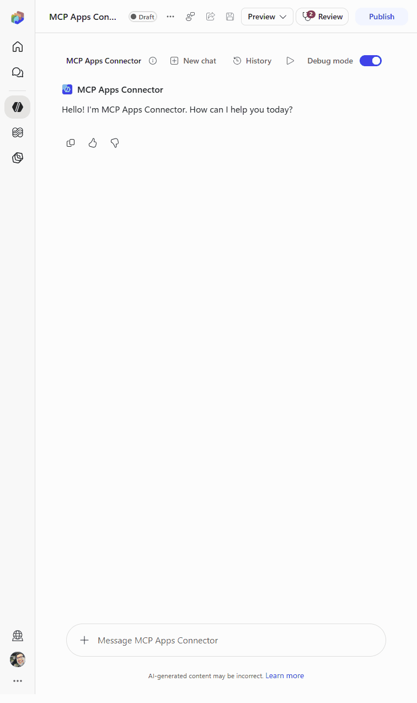
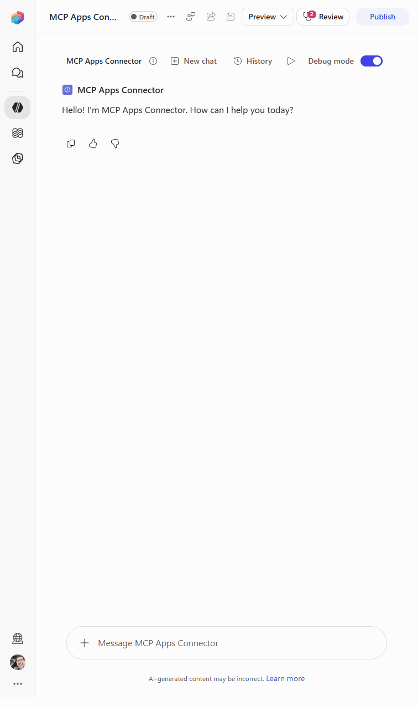
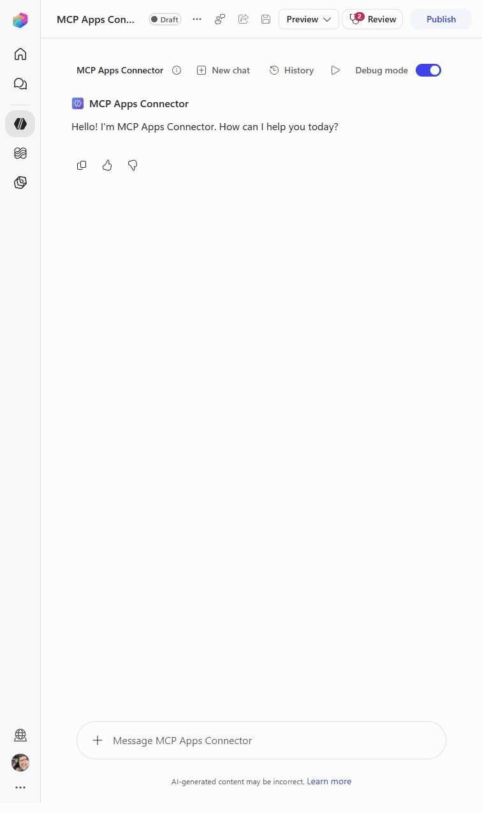
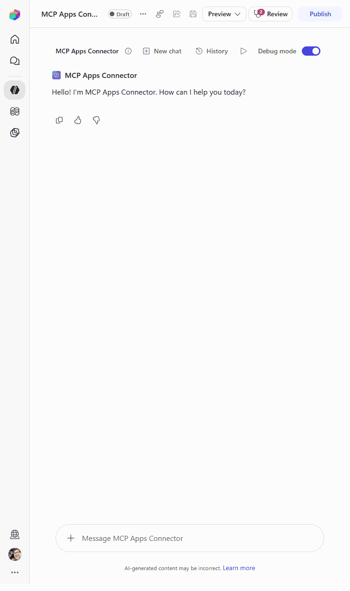
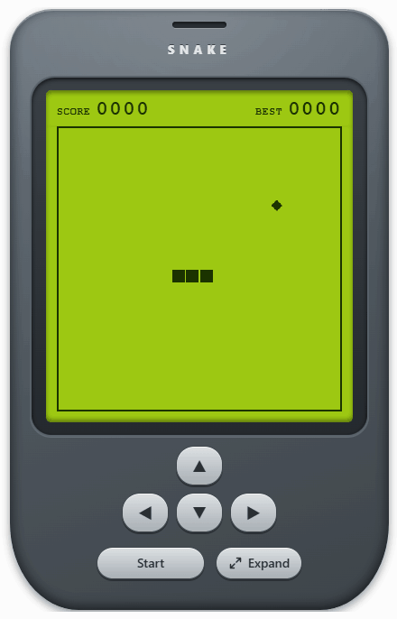
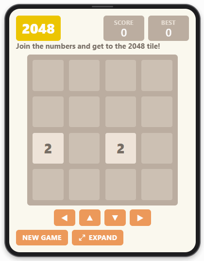
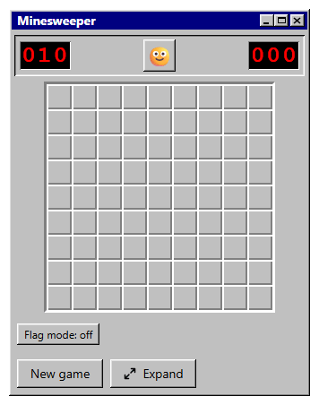
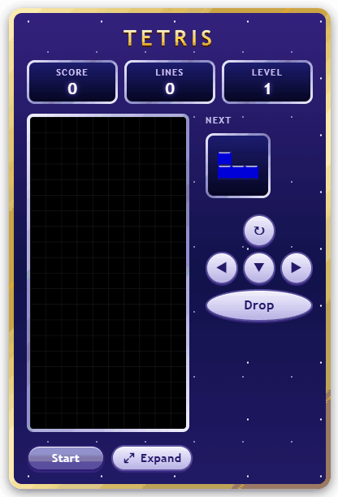

# Power MCP Games

Nine playable games for a Copilot Studio agent, delivered as [MCP Apps](https://learn.microsoft.com/microsoft-copilot-studio/agents-experience/mcp-apps): Snake, 2048, Minesweeper, Tetris, Cyber Trivia, Word Guess, Sudoku, Breakout, and Solitaire. Ask the agent to play one and the game appears in the conversation.

One connector serves the MCP endpoint, the tools, and the game views. The script hosts the HTML for each game as a `ui://` resource, so there is no web app, storage account, or CDN to deploy. It is a companion to [Power MCP Cards Template](../Connector-Code/Power%20MCP%20Cards%20Template/) and shares its MCP framework, Fluent styles, and host bridge.

## See it play

Ask the agent for a game in chat, and the game appears in the conversation:

| Snake | 2048 | Minesweeper | Tetris |
|:-----:|:----:|:-----------:|:------:|
|  |  |  |  |

Just the games:

| Snake | 2048 | Minesweeper | Tetris |
|:-----:|:----:|:-----------:|:------:|
|  |  |  |  |

## Games and tools

| Tool | Game | Argument | Ways to play |
|------|------|----------|--------------|
| `play_snake` | Steer the snake to the food without hitting a wall or yourself. | `speed`: `slow`, `normal`, `fast` | Arrow keys or WASD, swipe, on-screen arrows |
| `play_2048` | Slide tiles so matching numbers merge, up to 2048. | `gridSize`: 3 to 6 (default 4) | Arrow keys or WASD, swipe, on-screen arrows |
| `play_minesweeper` | Reveal every safe cell. Your first click is always safe. | `difficulty`: `easy` (9×9, 10 mines), `medium` (16×16, 40), `hard` (30×16, 99) | Click to reveal, right-click or flag mode to flag |
| `play_tetris` | Clear lines with falling blocks. A ghost piece shows where the block will land. | `level`: 1 to 20 (default 1) | Arrow keys, space to drop, `P` to pause, on-screen buttons |
| `play_cyber_trivia` | A security awareness quiz for employees, played as a game show with a snarky host, a money clock, and a double-value final question. | `category` (a topic, `all`, or `company`), `count`: 5 to 20 (default 10), `level`: `any`, `basic`, `intermediate`, `timed` (default true), `tone`: `cheeky` or `plain`, `companyName`, `reportTo`, `customQuestions` | Tap or click an answer, or press `A` to `D` or `1` to `4`, then **Next** |
| `play_word_guess` | Find the hidden five-letter word. Each guess shows which letters are in the right place, in the word but elsewhere, or not in the word. | `word` (optional, for a themed round), `maxGuesses`: 4 to 8 (default 6), `hardMode`, `highContrast` | On-screen keyboard, or type and press Enter |
| `play_sudoku` | Fill the 9×9 grid so every row, column, and box holds 1 to 9. | `difficulty`: `easy`, `medium`, `hard`, `expert` (default `medium`), `puzzle` (optional, 81 characters), `seed` (optional) | Tap a cell, then a number. Keys: `1` to `9`, arrows, `N` for notes, `Z` to undo, `H` for a hint |
| `play_breakout` | Bounce the ball off the paddle to break every brick. Five wall layouts, and the ball speeds up as bricks clear. | `level`: 1 to 5 (default 1), `lives`: 1 to 5 (default 3), `speed`: `slow`, `normal`, `fast` | Drag or move the pointer over the board, arrow keys, on-screen buttons. Tap or press space to launch |
| `play_solitaire` | Klondike in a Windows 98-style window, with a score and time bar underneath and eight card backs. Build four piles from ace to king. | `drawCount`: 1 or 3 (default 1), `deal` (optional), `cardBack`: 1 to 8 (default 1) | Tap a card, then where it goes. Double-tap sends a card to its pile. **Undo**, **Deck** (changes the card back), and auto-complete included |

Every tool returns a plain-text note alongside the game's settings. The note tells the agent that the game is shown, to keep its reply to one short sentence, and what to say if the user can't see the game. So a client that can't render MCP Apps still gets a sensible reply, and the agent doesn't try to play the game in text.

### Cyber Trivia

A quiz for company employees. The 80 questions come from a fixed, built-in bank, not from the agent, so the agent personalizes the quiz but doesn't write security guidance.

- **Game show format.** A host named Pat Ching (an original character) welcomes you and comments on each answer. Each question starts at $1,000 and rises by $100 a question up to $2,000, and the last question is worth double. In the default timed mode a 20-second clock ticks the value down. A right answer wins what is on the clock, a wrong answer costs the full starting amount, and running out of time costs nothing. Your final cash can be negative. Set `timed` to `false` for a flat value with no clock, which is better for slow readers and screen reader users. Set `tone` to `plain` to turn the host off for a more formal audience. The clock pauses when the card loses focus, for example while you type in the chat, and resumes when you click back in.
- **Topics:** phishing, passwords and MFA, social engineering, safe browsing, data handling, devices, remote work, using AI safely, physical security, and reporting incidents. Eight questions each, half basic and half intermediate. A mixed quiz takes questions from every topic in turn.
- **Basis:** current guidance from CISA, NIST (for example SP 800-63B, which favors length over complexity and drops forced password changes), and Microsoft security documentation. Have your security awareness owner review the bank before you roll the quiz out, and adjust it to your policies. The bank is in `TriviaBank` in `script.csx`; bump `Version` when you change it.
- **Your details:** `companyName` and `reportTo` fill in the questions, for example "report it to secops@contoso.com". The defaults are "your company" and "your security team".
- **Your own questions:** pass `customQuestions` as JSON text, up to 20 questions. Play only your questions with `category` set to `company`, or mix them into a quiz.

  ```json
  [
    {
      "stem": "A visitor asks to borrow your badge to reach the lab. What do you do?",
      "correct": "Say no and call reception",
      "wrong": ["Lend it for five minutes", "Lend it if they leave ID"],
      "explain": "Badges are personal.",
      "action": "Call reception on extension 100."
    }
  ]
  ```

- **No record is kept.** The connector stores nothing, and the end screen says so. A result is practice, not a training record. The card tells the agent your final cash, how many answers were right, and your weakest topics in the chat, so the agent can offer follow-up coaching.
- **Answers are not secret from the agent.** The card needs the correct answers to give feedback, so they travel in the tool result. The connector tells the agent not to reveal them, but don't use the quiz where cheating matters.

### Word Guess

The card picks a random word, and the agent never sees it. Set `word` only for a themed round where you want to choose the word. About 1,000 common words can be picked as answers, and about 5,000 words are accepted as guesses. Anything else shakes the row and is not accepted. The lists come from ENABLE, a public-domain word list, ranked with Peter Norvig's word counts; they aren't copied from any commercial game. `hardMode` requires each guess to use the hints already revealed. `highContrast` swaps green and amber for orange and blue.

### Sudoku

Puzzles are made in the card and always have exactly one solution. Difficulty sets the number of given numbers (40, 34, 28, or 24), which is only a rough guide to how hard a puzzle feels. The same `difficulty` and `seed` always make the same puzzle, so you can replay one. **Hint** fills in the correct number for a wrong cell, the selected empty cell, or the most constrained empty cell, and shows it in italic purple. Hints are counted and shown when you finish. **Check** marks wrong numbers as you go.

### Breakout and Solitaire

Breakout runs a real-time loop in the card. If your host throttles animation in a card, use the on-screen arrow buttons. Solitaire scores like Windows (+10 to a pile, +5 for turning a card over, −15 for taking a card back, −100 for recycling in draw one). The same `deal` number always gives the same shuffle.

Solitaire's cards have number pips and corner indexes, and the jack, queen, and king have a framed face. The score, time, and moves sit in a status bar under the table, as in Windows 98. Select **Deck** to cycle through eight card backs: a weave, a robot, two fish scenes, a seashell, a castle at night, a palm beach, and a hand holding cards. The backs are small original drawings inspired by that kind of classic card deck; they are not Microsoft's artwork. Pass `cardBack` to start with a particular one.

## How the games work

Each game follows the same pattern:

- A card with the game title, its score, the board, and two actions: a primary button and **Expand**. The primary button is **Start**, **Pause**, **Resume**, or **Restart** for Snake and Tetris, **Launch**, **Pause**, **Resume**, or **Play again** for Breakout, **Next** or **Play again** for Cyber Trivia, and **New game**, **New word**, or **New puzzle** for the rest. Minesweeper also has a smiley button that starts a new game.
- **More than one way to play.** A card in a sandboxed frame might never receive keyboard focus, so every game also works with on-screen buttons, and the board takes focus when you click it. Snake and 2048 also respond to swipes. Minesweeper has a flag-mode toggle for touch screens, where there is no right-click.
- **Pausing.** Snake, Tetris, and Breakout pause when the card is hidden or loses focus, so a game doesn't end while you type in the chat. Sudoku and Solitaire stop their timers, and Cyber Trivia's clock stops and reads **PAUSED**. A paused board shows **PAUSED**.
- **Results.** Snake, Tetris, and Breakout draw **GAME OVER** and the score on the board, 2048 shows an overlay with **Try again** (or **Keep going** after you reach 2048), and Minesweeper's smiley changes face. Cyber Trivia shows a results screen with your cash, your weak topics, and the questions you missed. Word Guess colors the tiles and reveals the word as a row of tiles if you run out of guesses. Sudoku and Solitaire show the result in the line under the title. No game uses pop-up message boxes, and the card stays the same size throughout play. A hidden announcement tells screen readers the result.
- **Expand.** The button asks the host for full screen and the board gets larger. If the host refuses, the button hides itself.
- **Theme.** Each game sits in its own frame and has its own look, drawn from a classic reference. Snake is a Nokia 3310 with a green LCD. 2048 is cream and orange with a yellow logo tile, inside a phone bezel. Minesweeper and Solitaire share a Windows 95 window frame; Solitaire adds a Windows 98 status bar and card backs. Tetris is a Super NES-style screen: a purple starfield in a gold frame, silver-bordered panels, and lavender buttons, with Tetris Guideline piece colors and beveled blocks on a black board. Cyber Trivia is a loud game-show set: a purple stage with hot pink and yellow trim, a money counter, and a host speech bubble. Word Guess is wooden tiles on a felt tray. Sudoku is a newspaper puzzle page. Breakout is an arcade cabinet with a black screen and rainbow rows. The colors are fixed, so the games look the same in light and dark themes.
- **Reporting the result.** When a game ends, the card tells the agent with `ui/update-model-context`, for example "The user finished a game of Snake with a score of 12." The agent can congratulate the player or offer another round. The connector keeps no scores itself.

## Where games render

| Surface | Renders the game? |
|---------|-------------------|
| Copilot Studio preview chat | Yes. See [Use MCP apps in Copilot Studio](https://learn.microsoft.com/microsoft-copilot-studio/agents-experience/mcp-apps). |
| Microsoft Copilot | Yes. |
| Teams and web chat | No. |
| Any client that does not support MCP Apps | No. The tool result carries a plain-text note instead. |

## Prerequisites

- A Power Platform environment where you can create custom connectors
- A Copilot Studio agent in a tenant where MCP Apps rendering is available
- [Power Platform CLI](https://learn.microsoft.com/power-platform/developer/cli/introduction) (`pac`)

## Set up

1. Copy this folder.
2. In `apiDefinition.swagger.json`, replace `your-api-host.com` with your own host name for the connector. The script handles the MCP request itself, so the host does not need to serve anything.
3. In `apiProperties.json`, set `publisher` to your name.
4. Deploy the connector:

   ```powershell
   pac connector create `
       --api-definition-file apiDefinition.swagger.json `
       --api-properties-file apiProperties.json `
       --script-file script.csx `
       --environment <YOUR_ENVIRONMENT_ID>
   ```

5. In Copilot Studio, open your agent, go to **Tools**, select **Add a tool**, choose **Connector**, and pick **Power MCP Games**.
6. Add the tools you want. Each game is its own tool.
7. Open the preview chat and try a prompt from the next section.

## Try it

| Prompt | What you should see |
|--------|---------------------|
| "Let's play Snake." | A board with a three-segment snake and a Start button. Pressing Start, an arrow key, or a swipe begins the game. |
| "Play Snake on fast." | The same game at a faster speed. |
| "Start a game of 2048 on a 5 by 5 grid." | A 5×5 board with two tiles. |
| "Play hard Minesweeper." | A 30×16 board with 99 mines. Use Expand for more room. |
| "Play Tetris starting at level 5." | A 10×20 board, a next-piece preview, and controls beside it. |
| "Quiz me on phishing." | Cyber Trivia with ten phishing questions. Pat Ching introduces the show, a money clock counts down on each question, and an explanation follows each answer. |
| "Run a security quiz without the clock or the jokes." | The same quiz with `timed` off and `tone` set to plain. |
| "Run a security awareness quiz for Contoso. Send problems to secops@contoso.com." | A mixed quiz whose answers mention Contoso and that address. |
| "Let's play Word Guess." | An empty 6×5 grid and an on-screen keyboard. |
| "Give me a hard Sudoku." | A 9×9 grid with 28 given numbers, a number pad, and Notes, Erase, Undo, Hint, and Check buttons. |
| "Play Breakout on fast." | A black board with six rainbow rows and a paddle. Tap to launch the ball. |
| "Deal me a draw-three Solitaire game." | A Windows 98-style window with seven columns, a stock pile, four empty foundation piles, and a score and time bar underneath. |
| "Deal me Solitaire with the robot card back." | The same table with the robot design on the face-down cards. |
| After a game ends: "How did I do?" | The agent knows your score from the result the card reported. |

Click the board before you use the keyboard, so the card has focus.

## Make it yours

To add a game:

1. Add a `ui://` URI constant and register the view in `RegisterGameViews` with `handler.AddUiResource(...)`.
2. Add a `play_*` tool in `RegisterGameTools`. Return `GameResult(text, data)`, where `data` holds the settings the game needs. Keep the schema flat, with no `$ref` and no multi-type arrays, because Copilot Studio drops tools that use them. Clamp numeric arguments in the handler with `GetInt` instead of putting bounds in the schema.
3. Add a view method to `GameViews`, with a CSS constant and a JavaScript constant.
4. In the JavaScript, call `gameShell({ title, board, stats, controls })`. It builds the card and returns a small kit. The config also takes optional `cls` (a class added to the card, for per-game styling; add `w95` to get the shared Windows 95 window), `intro` (a line of text under the header), and `mid` (an element placed between the first and second stat), and `screen` (set to `true` to put the stats and board together in one bordered screen, as Snake does):
   - `kit.stat(id, value)` updates a score.
   - `kit.announce(text)` tells screen readers a result without changing the layout.
   - `kit.label(text)` and `kit.onPrimary(fn)` set up the primary button, and `kit.disable(true)` turns it off.
   - `kit.onKey(fn)`, `kit.onSwipe`, and `kit.onAway` (card hidden or unfocused) wire up input. `fn` receives the key, whether the board has focus, and the event target.
   - `kit.onStop(fn)` clears timers when the card is rebuilt.
   - `kit.report(text, data)` tells the agent the result.

   There is no banner or hint-box API, on purpose. Show results and feedback on the board itself (an overlay drawn on the canvas, a shaking row, a highlighted cell) or in the `intro` line, so the card never changes size.

   **Keep the card the same size.** The frame height must not change while a game is played. Reserve space for anything that appears later (a hidden row that is revealed, a line that is always one line tall, a board with a fixed height), and measure the worst case up front if the content varies, as Cyber Trivia does with a hidden copy of its tallest question. As a safety net, the shared host bridge lets the frame grow but never shrink while it is inline.

   Shared helpers: `mulberry32(seed)` and `shuffle(list, rng)` for replayable randomness, `fmtTime(seconds)`, and `makeTimer(tick)` for a clock.
5. End the script with `start('Name', sampleData, yourFunction, ['inline', 'fullscreen'])`. The sample data lets the page run on its own in a browser for development.

The JavaScript lives in C# verbatim strings, so use single quotes only. Show data with `textContent`, never `innerHTML`.

## Security

- The views declare no content security policy, so the host applies its restrictive default: no network access and no external scripts. The games load nothing from a CDN.
- Games run entirely in the card. The connector keeps no state and stores no scores. It makes no outbound calls unless you set `APP_INSIGHTS_CONNECTION_STRING` in `script.csx`, which turns on optional Application Insights telemetry. It is empty by default.
- Add authentication to the connector before you expose it beyond a test environment.

## Limits

- The connector is request and response. It can't push updates to a card, and it doesn't keep scores between games.
- Games run in the card, not on the server, so a high score lasts only as long as the card is open.
- Cyber Trivia can't check an answer on the server, because not every host lets a card call tools. The card checks answers itself, which is why the answers are in the tool result.
- Solitaire doesn't support dragging cards. Tap a card, then tap where it goes.
- Hosts support different parts of MCP Apps. These games use `ui/initialize`, tool results, `ui/update-model-context`, display-mode requests, and size changes. Copilot Studio provides only theme, language and region, and display mode as host context, so the games use their built-in Fluent colors for anything else. It doesn't support tool cancellation, partial tool input, file downloads, or MCP logging.
- Minesweeper's hard board is about 690 pixels wide and scrolls sideways in a narrow card. Use Expand.

## Troubleshooting

| Symptom | Cause and fix |
|---------|---------------|
| The agent answers in text and no game appears | You're in a surface that doesn't render MCP Apps. Games render in the Copilot Studio preview chat and Microsoft Copilot, not in Teams or web chat. If you are in the preview chat, check that the `resources/read` for the game isn't failing, because that hides the card without changing the tool result. |
| The game appears but the keyboard does nothing | The card doesn't have focus. Click the board, or use the on-screen buttons or a swipe. |
| The game paused by itself | Snake, Tetris, and Breakout pause when the card is hidden or loses focus. Select Resume. |
| Word Guess won't take a guess | The row shakes when a guess isn't one of about 5,000 accepted words, or isn't five letters, or breaks hard mode. Try a more common word. |
| Breakout stutters or the ball barely moves | Your host is throttling animation in the card. Try Expand, and use the on-screen arrow buttons if dragging doesn't move the paddle. |
| Right-click doesn't flag a cell | Some hosts block the context menu. Turn on **Flag mode** under the board. |
| Expand does nothing and then disappears | The host doesn't offer full screen. The board stays inline. |
| A tool is missing in Copilot Studio | Copilot Studio drops tools whose schema has `$ref` or multi-type arrays. Keep custom schemas flat. |
| The agent says it can't see a tool you added | The agent keeps the tool list from when you added the connector. Remove the connector's tools from the agent and add them again. |
| The card shows "needs a host that supports MCP Apps" | The host didn't answer `ui/initialize`. The card is running somewhere other than an MCP Apps host. |
