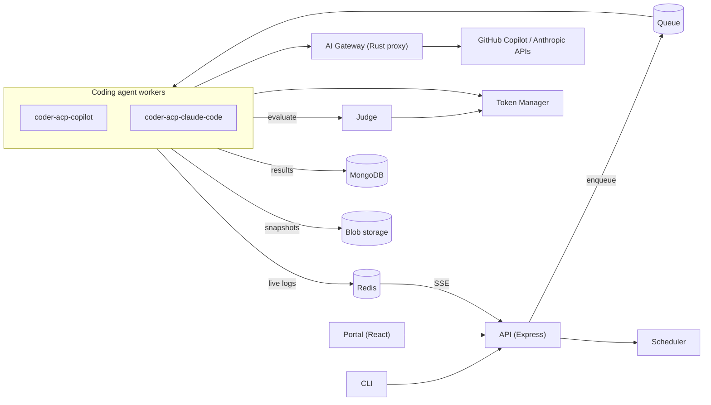

<div align="center">

  <h1>&nbsp;Scope</h1>

  <p><strong>An open-source agentic experience evaluation platform.</strong></p>

  <p>
    Evaluate how AI agents use your product, approach real tasks, and respond to feedback.
    Define success with reusable criteria, follow each run live, and inspect the
    evidence behind every result through the Portal or CLI.
  </p>

  <p>
    <a href="./LICENSE"></a>
  </p>
</div>

## Contents

- [What is Scope?](#what-is-scope)
- [Key concepts](#key-concepts)
- [Architecture](#architecture)
- [Quick start (local)](#quick-start-local)
- [Using the CLI and API](#using-the-cli-and-api)
- [Repository layout](#repository-layout)
- [Configuration](#configuration)
- [Development](#development)
- [Self-hosting and deployment](#self-hosting-and-deployment)
- [Troubleshooting local setup](#troubleshooting-local-setup)
- [Documentation](#documentation)
- [Contributing, support, and security](#contributing-support-and-security)
- [License](#license)

## What is Scope?

AI coding agents are becoming users of your software: they discover APIs, pick SDKs,
follow documentation, and call tools on a developer's behalf. Scope helps you measure
that experience. You give agents a representative task, define what a good outcome
looks like, run the experiment repeatedly, and inspect the evidence, so you can decide
what to improve in your docs, SDKs, tools, or agent guidance, and then evaluate again.

Scope:

- **Drives existing coding agents** (GitHub Copilot and Claude Code today) in isolated
  containerized workers.
- **Scores results** with a Judge service that evaluates output against a directed
  acyclic graph (DAG) of reusable criteria.
- **Keeps the evidence**: live logs, agent trajectories, per-criterion rationale, and
  workspace snapshots for every run.
- **Makes experiments repeatable** with versioned profiles (worker, model, agent
  version, skills, MCP servers) and versioned codebases.
- **Runs where you want**: locally with Docker Compose, or self-hosted on Kubernetes.
  It is software you deploy, not a hosted service.

Scope is a research preview. Results describe the scenarios you evaluate; they are not
a general ranking of agents, and automated judges can be wrong. Use representative
tasks, repeated runs, and human review of the evidence when making decisions.

## Key concepts

| Concept | Description |
|---------|-------------|
| **Request** | What you submit: a task prompt, a set of criteria IDs, a profile (or inline runtime configuration), and optionally a codebase. |
| **Run** | One execution attempt of a request. A retry adds a new run. Logs and reports are per run. |
| **Task prompt** | The instructions sent to the agent. Prompts are de-duplicated by text across requests. |
| **Criteria** | Observable checks the Judge evaluates. They form a DAG: a criterion with `dependsOn` is evaluated only if its parents pass. |
| **Profile** | A versioned agent setup: worker, model, agent version, MCP servers, skills, extensions. Saved versions are immutable. |
| **Codebase** | A reusable starting project (from GitHub or an upload) with immutable, numbered revisions. |
| **Worker** | The runtime that drives a coding agent (GitHub Copilot CLI, Claude Code CLI). |
| **Judge / report** | The service that evaluates a run against its criteria and the structured pass/fail result it produces. |
| **Persona** | The simulated user's perspective and feedback style for multi-turn runs. |
| **Gates** | Optional stages (`Select`, `Build`, `Test`, `Run`, `Deploy`) with their own prompt, criteria subset, and iteration budget. |
| **Prompt feature** | A tag Scope detects on a prompt (for example `asks_for_api`) so you can group and compare runs. |

See [Concepts](https://microsoft.github.io/scope/introduction/concepts/) for details.

## Architecture



A benchmark run flows through these steps:

1. **Submit**: a user submits a request through the Portal, CLI, or REST API. The API
   validates the worker, model, and criteria, creates the run record, and enqueues it.
2. **Execute**: a worker dequeues the request, prepares the workspace (optionally from a
   codebase), and drives the coding agent.
3. **Stream**: workers publish log events to Redis; the API relays them as
   Server-Sent Events to the CLI and Portal.
4. **Judge**: the Judge evaluates the output against the criteria DAG, using
   credentials from the Token Manager. Results are stored in MongoDB.
5. **Snapshot and report**: workspace snapshots go to blob storage, and the report
   generator and post-processor produce analysis for later review.

Locally, MongoDB, Redis, Azurite (blob and queue storage), a local secret store, and a
local Entra sign-in emulator run as containers. In Azure, they are Cosmos DB (MongoDB
API), Azure Managed Redis, Storage, and Key Vault, with KEDA scaling workers from the
queue.

Read the [system overview](docs/architecture/overview.md) and
[application design](docs/architecture/app-design.md) for more.

## Quick start (local)

### Prerequisites

| Tool | Requirement |
|------|-------------|
| Git | To clone the repository. |
| Node.js | Version 22. |
| pnpm | Version 10.29.1 (pinned in [package.json](package.json)). |
| Docker | Current Docker with Compose v2 (Compose Watch support). |
| [mkcert](https://github.com/FiloSottile/mkcert) | Trusted HTTPS certificates for the local sign-in emulator. |
| [GitHub CLI](https://cli.github.com/) | Obtain a token with `gh auth login`. |

The Copilot worker needs an active GitHub Copilot entitlement on the account that
supplies its token. You also need credentials for the models used by the Judge and
other AI features; provider usage can incur charges or consume quotas. The scripts use
Bash, so on Windows run them from Git Bash, or use the
[Windows helper script](docs/local-setup-windows.md), which handles the differences.

### Start the stack

```bash
git clone https://github.com/microsoft/scope.git
cd scope
corepack enable
pnpm install --frozen-lockfile

gh auth login
GITHUB_TOKEN="$(gh auth token)" pnpm docker:dev:copilot
```

This builds and starts the Copilot worker, Portal, API, scheduler, Judge, token manager,
gateway, report generator, post-processor, and their local dependencies. Database
migrations and development agent registration run automatically. The first build
downloads and compiles a lot and can take a while. On first use the scripts run
`mkcert -install`, which adds a local certificate authority to your OS and browser trust
store.

To use Claude Code instead, run `pnpm docker:dev:claude-code`. To enable both workers,
run `pnpm docker:dev:all`. Stop the stack with `pnpm docker:down`.

### Open the Portal

```bash
pnpm open:portal
```

The default address is <http://localhost:5100>. Local sign-in uses seeded emulator
users such as `alice@entralocal.dev`, not a production Entra tenant. The API listens on
<http://localhost:3100> (OpenAPI explorer at `/api-docs`).

### Register a credential for the Judge

The Judge needs a stored credential with the `copilot-sdk` capability. Register one in
the Portal's **Secrets** tab or with the CLI (see below):

```bash
gh auth token | pnpm cli secret create --type github-oauth --value-stdin --comment "<comment>"
```

If the Judge model defaults aren't available to your account, override them in
`.env.local`:

```bash
JUDGE_MODEL=<model>
FEEDBACK_MODEL=<model>
REPORT_MODEL=<model>
```

### Run your first evaluation

1. Select or create a project.
2. Create a task and at least one observable criterion. For example, ask the agent to
   create a Node.js HTTP server and judge whether its source implements a `GET /health`
   route that returns JSON.
3. Open the run submission page, choose the running Copilot agent and a model, and
   attach the task and criteria. Optionally save the setup as a profile.
4. Submit the request, follow the live logs, and inspect the Judge's results and
   workspace artifacts.

## Using the CLI and API

Commands in this section use placeholders. Replace each one with your own value:

| Placeholder | Value |
|-------------|-------|
| `<scope-api-url>` | The base URL of your Scope API. Locally this is `http://localhost:3100` unless your `.env` sets a different `API_PORT`. |
| `<project-id>` | A project ID from `pnpm cli project list`. |
| `<worker-id>` | A registered worker ID from `pnpm cli agent list`, for example the Copilot worker. |
| `<model>` | A model your account can use, listed by `pnpm cli agent list`. |
| `<criterion-id>` | A lowercase snake_case ID for your criterion. |
| `<criterion-prompt>` | The statement the Judge evaluates against the run's output. |
| `<task>` | The prompt you send to the agent. |
| `<run-id>` | The run ID printed when you submit. |
| `<comment>` | A note describing a stored credential. |

Install the public CLI:

```bash
curl --fail --location https://raw.githubusercontent.com/microsoft/scope/main/install-cli.sh | bash
```

Or build it from this repository and run it through pnpm:

```bash
pnpm build:cli
export SCOPE_API_URL=<scope-api-url>   # point the CLI at your API (or pass -u)
pnpm cli project list
pnpm cli project use <project-id>
pnpm cli criteria create --id <criterion-id> --prompt "<criterion-prompt>"
pnpm cli run submit -w <worker-id> --model <model> -c <criterion-id> -m "<task>"
pnpm cli run status -i <run-id>
pnpm cli run get -i <run-id> -o json
```

Useful command groups: `run` (submit, status, get, logs, list, cancel, retry, download),
`criteria` (list, create, import, export, graph), `agent` (list, models, versions),
`secret` (list, create), and `project`. Run `pnpm cli --help` for the full list. A
request needs a selected project (`--project`, `SCOPE_PROJECT`, or `project use`), a
task, and criteria.

The REST API is served under `/api/v1` on the same host (for example, `POST
<scope-api-url>/api/v1/requests?projectId=<project-id>`). Use the interactive explorer at
`<scope-api-url>/api-docs` or the
[REST API reference](https://microsoft.github.io/scope/reference/api/). A deployment may
require authentication; the local stack does not.

## Repository layout

This is a pnpm workspaces monorepo written in TypeScript (strict mode, ES2022, NodeNext
modules), with a Rust gateway and an Astro documentation site.

```text
apps/
  api/                          REST API: run orchestration, SSE log streaming, criteria CRUD
  cli/                          CLI: submit runs, stream logs, manage criteria and secrets
  portal/                       React web UI: runs, insights, criteria graph editor
  judge/                        Evaluates agent output against the criteria DAG
  scheduler/                    Request scheduling
  token-manager/                Credential storage, validation, and distribution
  gateway/                      Rust TLS-intercepting AI gateway (plugin architecture)
  workers/
    coder-acp-copilot/          GitHub Copilot worker (Agent Client Protocol)
    coder-acp-claude-code/      Claude Code worker (Agent Client Protocol)
    coder-acp-copilot-windows/  Windows-container variant of the Copilot worker
    report-generator/           Post-run analysis reports
    post-processor/             Post-run processing
  model-scanners/               Detect available models for Copilot and Anthropic
  version-checkers/             Poll for new agent and tool releases
  key-updaters/                 GitHub auth cookie management
packages/
  shared/                       Shared types and utilities
  db-migrations/                Lightweight MongoDB migration framework
  llm-eval/                     LLM evaluation helpers
  model-scanning/               Model discovery library
  version-checking/             Release polling library
  github-auth/                  GitHub authentication helpers
  telemetry/                    Telemetry utilities
  test-utils/                   Shared test helpers
config/                         Portable example criteria, scenarios, personas, and traits
evaluations/static-prompts/     Static prompt quality and red-team suites
infra/                          Azure infrastructure (Bicep, azd)
docs/                           Architecture, infrastructure, operations, and research docs
website/                        Documentation site (Astro), published at microsoft.github.io/scope
scripts/                        Dev, build, and tooling scripts
.k3d/                           Local Kubernetes (k3d) configuration
```

## Configuration

- [.env.base](.env.base) holds shared defaults, and the start scripts generate `.env`
  from it. Don't edit `.env` or put credentials in `.env.base`.
- Put persistent local overrides in `.env.local` (start from
  [.env.local.example](.env.local.example)). Never commit it.
- [ENV_VARIABLES.md](ENV_VARIABLES.md) documents every variable, including provider
  credentials and the Judge, feedback, and report models.
- The YAML in [config/](config) is a set of portable examples. MongoDB is the runtime
  source of truth, so manage live configuration through the Portal or CLI, for example
  with `pnpm cli criteria import`.
- Provider credentials belong in the Portal's **Secrets** tab or the Token Manager API,
  not in source control.

## Development

Common commands (run from the repository root):

| Command | Purpose |
|---------|---------|
| `pnpm docker:dev:copilot` / `docker:dev:claude-code` / `docker:dev:all` | Start the local stack with hot reload. |
| `pnpm docker:dev:portal` | Start only the Portal and auth stack. |
| `pnpm docker:down` | Stop the stack. |
| `pnpm build` / `pnpm build:cli` | Build the workspace or the CLI. |
| `pnpm lint` | Lint. |
| `pnpm test` / `pnpm test:coverage` | Unit tests. |
| `pnpm test:integration` | Integration tests. |
| `pnpm test:eval` | Evaluation tests. |
| `pnpm eval:static-prompts` | Static prompt quality and red-team suites. |
| `pnpm build:gateway` / `pnpm test:gateway` / `pnpm lint:gateway` | Rust gateway build, test, and lint. |
| `pnpm migrate:up` / `pnpm migrate:down` | Apply or roll back database migrations. |
| `pnpm storybook` | Portal component stories. |
| `pnpm notice:check` / `pnpm headers:check` | Verify third-party notices and license headers. |

Read [CONTRIBUTING.md](CONTRIBUTING.md) for prerequisites, debugging the Docker
development API, coding conventions, and the pull request process. [AGENTS.md](AGENTS.md)
and [CLAUDE.md](CLAUDE.md) describe conventions for AI coding assistants working in this
repository.

## Self-hosting and deployment

Scope can be self-hosted on Kubernetes. The documented Azure option provisions an AKS
cluster, Cosmos DB, Azure Managed Redis, Storage, Key Vault, and a container registry
with Bicep and `azd`, and installs the core services with Helm. Core services are the
API, Portal, Judge, Token Manager, Scheduler, and Report Generator, plus optional
coding-agent workers. KEDA scales workers from the queue. Identity is split so worker
pods, which run agent-controlled code, have no Key Vault access.

- [Self-hosting overview](https://microsoft.github.io/scope/self-hosting/overview/)
  ([source](website/src/content/docs/self-hosting/overview.md))
- [Provision Azure infrastructure](website/src/content/docs/self-hosting/provision-aks.mdx)
  and the [Helm deployment guide](website/src/content/docs/self-hosting/deploy-helm.md)
- [Configuration](website/src/content/docs/self-hosting/configuration.md),
  [scaling with KEDA](website/src/content/docs/self-hosting/scaling.md), and
  [operations](website/src/content/docs/self-hosting/operations.md)
- [Cosmos DB backup and restore](docs/ops/cosmos-backup-restore.md)

You choose the connected services and manage access to experiment data and credentials.
Running agents and model-based evaluation needs access to the corresponding providers.

## Troubleshooting local setup

| Symptom | Likely cause and fix |
|---------|----------------------|
| Image builds fail with `ECONNRESET`, `EAI_AGAIN`, or 502 errors | Many parallel package downloads overwhelm DNS or a registry proxy. Retry with `COMPOSE_PARALLEL_LIMIT=1`. The build forwards your host npm registry automatically. |
| Compose reports the gateway is unhealthy and stops | The Rust gateway compiles from source on the first dev start, which can outlast the healthcheck. Wait until the gateway container is healthy, then run the same start command again. |
| Runs fail with `Judge evaluation failed: fetch failed` | The Judge can't reach the Token Manager, which may still be compiling or may have stopped. Check `docker ps`, wait for it to listen, and resubmit. |
| `No valid keys available for capability 'copilot-sdk'` | Register a GitHub credential in the Portal's **Secrets** tab or with `pnpm cli secret create`. |
| `Model "..." is not available` from the Judge | Set `JUDGE_MODEL`, `FEEDBACK_MODEL`, and `REPORT_MODEL` in `.env.local` to models your account can use, then recreate the Judge and report generator. |
| `pnpm` scripts fail with shell syntax errors on Windows | The scripts need Bash. Use the [Windows helper script](docs/local-setup-windows.md), or run them from Git Bash with Git Bash ahead of WSL's `bash.exe` on `PATH`. |
| `projectId` validation error from the API or CLI | Select a project with `pnpm cli project use <project-id>`, `--project`, or `SCOPE_PROJECT`. |
| The Portal sign-in certificate isn't trusted | Re-run `mkcert -install` and restart your browser. |

## Documentation

The **[official documentation website](https://microsoft.github.io/scope/)** has setup
instructions, evaluation workflows, architecture, and reference guides. Start with
[Getting started](https://microsoft.github.io/scope/getting-started/access/) or
[Local development](https://microsoft.github.io/scope/getting-started/local-development/).

In this repository, [docs/README.md](docs/README.md) indexes the architecture,
infrastructure, operations, responsible AI, and research documents. Component READMEs
include [apps/cli/README.md](apps/cli/README.md),
[packages/llm-eval/README.md](packages/llm-eval/README.md),
[evaluations/static-prompts/README.md](evaluations/static-prompts/README.md), and
[website/README.md](website/README.md).

## Contributing, support, and security

Contributions are welcome, including new agent integrations, reusable criteria,
improvements to analysis, and lessons from evaluating your own products. Read the
[contributing guide](CONTRIBUTING.md) first; contributions require a Contributor License
Agreement. This project follows the [Code of Conduct](CODE_OF_CONDUCT.md).

- Help: [SUPPORT.md](SUPPORT.md) and
  [Support and security](https://microsoft.github.io/scope/resources/support/)
- Vulnerability reporting: [SECURITY.md](SECURITY.md). Don't report vulnerabilities in
  public issues.

## License

Scope is released under the [MIT License](LICENSE). Third-party notices are in
[NOTICE](NOTICE).
